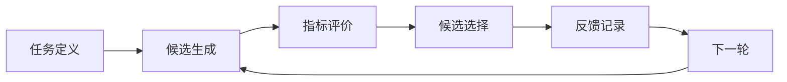

# AI4S-RSI-System

A generic workflow scaffold for AI-assisted research.

这是一个通用流程演示：从任务定义出发，生成候选、计算指标、完成选择，再将反馈传入下一轮。每轮记录保留候选、评价和选择依据，便于讲解与检查。

公开版本使用**本地合成适配器**，以二维参数和示例指标展示完整的数据流与反馈机制。演示无需外部模型或服务，示例指标仅用于说明流程。



## 快速运行

需要 Python 3.10 或更新版本。仅使用 Python 标准库，无需安装依赖。在仓库根目录运行：

```bash
python3 -m ai4s_rsi run --config configs/demo.json --output /tmp/ai4s-rsi-demo
python3 -m ai4s_rsi inspect /tmp/ai4s-rsi-demo
```

运行目录包含：

| 文件 | 用途 |
| --- | --- |
| `run.json` | 完整运行记录，供程序读取或进一步检查 |
| `summary.md` | 便于阅读的运行摘要 |

## 演示内容

候选使用统一结构：`candidate{id, parameters{x, y}}`。评价返回 `metrics{quality, cost}`，用于说明不同指标如何参与选择。

每轮记录包含 `round`、`proposals`、`evaluations`、`selected` 和 `feedback`。反馈作为下一轮的输入，展示显式规则如何影响后续候选生成。

- **模块化接口**：生成与评价适配器可独立替换。
- **明确的选择规则**：按指标排序，并记录保留的候选。
- **反馈迭代**：下一轮读取已有反馈，调整候选生成范围。
- **可检查的记录**：JSON 保存过程，Markdown 展示摘要。

无需运行也可查看[合成示例摘要](examples/demo_output.md)和[完整示例记录](examples/demo_run.json)。

## 仓库结构

```text
ai4s_rsi/              命令入口、流程编排与合成适配器
configs/demo.json      演示运行配置
examples/demo_task.json 示例任务
prompts/               通用模型接口提示词示例
docs/                  架构说明与演示步骤
tests/                 流程检查
```

阅读 [架构说明](docs/architecture.md) 了解模块职责与替换边界，阅读 [演示步骤](docs/demo.md) 查看如何运行和讲解示例。

流程检查：`python3 -m unittest discover -s tests -v`。
