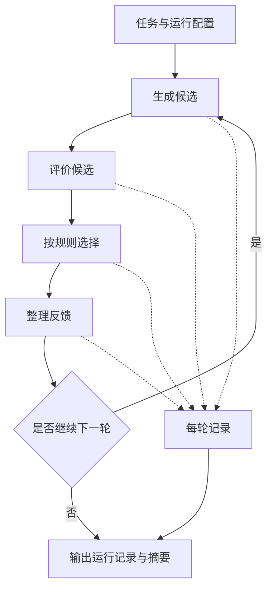

# 架构说明

流程编排与候选生成、指标评价分开组织。编排层负责轮次推进和记录；适配器负责具体的数据生成与评价。当前适配器全部采用本地合成逻辑。

## 数据流



下一轮接收前一轮反馈；循环在配置规定的轮次结束后停止。

## 模块职责

| 位置 | 职责 |
| --- | --- |
| `ai4s_rsi/__main__.py` | 解析命令，发起运行或检查已有结果 |
| `ai4s_rsi/pipeline.py` | 编排生成、评价、选择、反馈和记录步骤 |
| `ai4s_rsi/adapters.py` | 提供当前演示使用的合成生成与评价逻辑 |
| `configs/demo.json` | 保存运行配置 |
| `examples/demo_task.json` | 保存示例任务定义 |

## 数据约定

候选的最小结构如下。数值仅说明字段形式：

```json
{
  "id": "candidate-example",
  "parameters": {
    "x": 0.2,
    "y": 0.7
  }
}
```

评价指标使用 `metrics` 对象：

```json
{
  "quality": 0.65,
  "cost": 0.3
}
```

`quality` 和 `cost` 是合成演示指标。当前规则先按 `quality` 降序，再按 `cost` 升序排列；指标相同时按候选标识排序。反馈记录领先候选的参数和下一轮搜索半径。

每轮记录保留下列信息：

| 字段 | 含义 |
| --- | --- |
| `round` | 当前轮次 |
| `proposals` | 本轮生成的候选 |
| `evaluations` | 候选对应的指标记录 |
| `selected` | 选择步骤保留的候选 |
| `feedback` | 供后续轮次使用的反馈 |

运行结束后，`run.json` 保存完整记录，`summary.md` 提供阅读摘要。评价结果与候选标识应保持对应，以便追踪选择依据。

## 适配器替换边界

扩展时可以替换生成逻辑或评价逻辑，并保留编排层所需的数据约定。`ProposalAdapter.propose(task, round_number, count, feedback)` 返回候选；`EvaluationAdapter.evaluate(candidate)` 返回可对应到候选标识的指标。`run()` 支持传入这两类适配器。

当前合成生成器保留搜索中心，并在其附近采样。下一轮以领先候选为中心缩小搜索范围。`prompts/` 提供通用模型接口示例，当前运行使用本地规则。

通用编排代码只依赖这些明确的数据接口。特定环境中的连接配置和适配器实现可单独维护；本仓库保持合成演示所需的最小内容。

## 当前范围

本版本用于展示流程组织、数据接口与运行记录，不包含外部模型调用。更换适配器后产生的结果需要按其实际任务重新评价，不能沿用合成演示中的分数解释。
